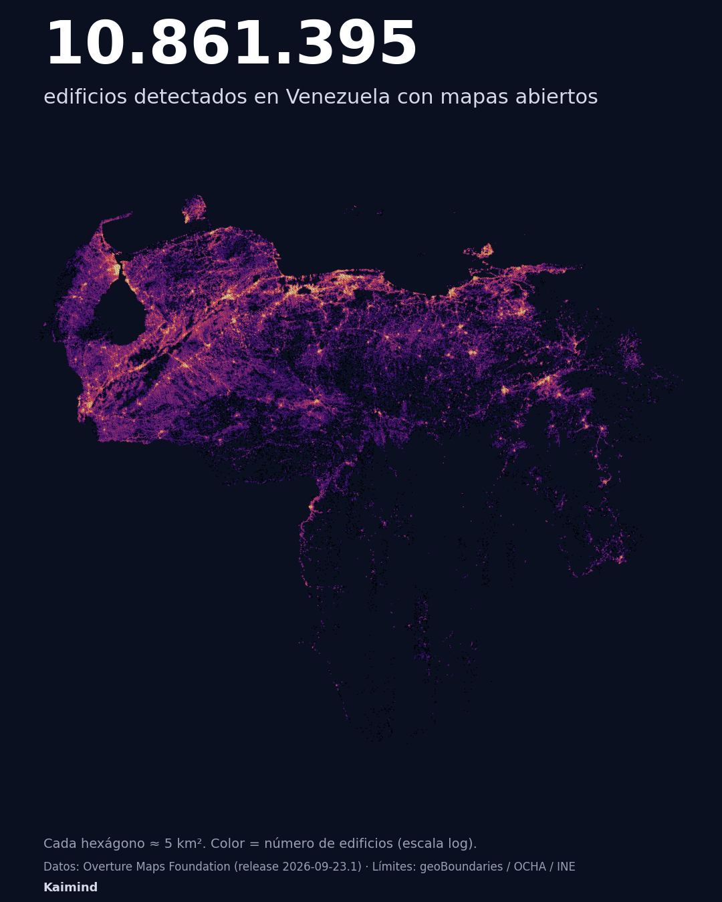

# P01 · ¿Cuántos edificios tiene Venezuela?

Venezuela no tiene censo desde 2011, pero los mapas abiertos ya contaron sus edificios: **10.861.395** (Overture Maps, release 2026-09-23.1).



## Resultados

| | |
|---|---|
| Edificios detectados | **10.861.395** |
| Detectados por IA | 92,1% (Microsoft 47,9% · Google 44,2%) |
| Mapeados por voluntarios (OpenStreetMap) | 7,9% |
| Estado con más edificios | Zulia (1.554.330) |

Top 5: Zulia 1.554.330 · Lara 824.152 · Carabobo 751.634 · Miranda 738.954 · Anzoátegui 657.925. Detalle completo en [`output/p01_cifras.json`](output/p01_cifras.json).

**Edificio ≠ vivienda.** Frente a las 8.216.443 viviendas del censo 2011 hay 1,32 edificios por vivienda, con un patrón claro: en el Distrito Capital hay 2,4 viviendas por edificio (apartamentos) y en Apure, 2 edificios por vivienda (anexos rurales). La cifra incluye construcciones no residenciales y anexos, y las imágenes satelitales son de distintos años.

## Ábrelo tú mismo

**[Abrir en GeoLibre](https://web.geolibre.app/?welcome=0&theme=dark&data=https%3A%2F%2Fraw.githubusercontent.com%2FKaimind-Technologies%2Fvenezuela-datos-abiertos%2Fmain%2Fp01-edificios-overture%2Foutput%2Fven_h3_r7.parquet&data=https%3A%2F%2Fraw.githubusercontent.com%2FKaimind-Technologies%2Fvenezuela-datos-abiertos%2Fmain%2Fp01-edificios-overture%2Foutput%2Fcaracas_edificios.parquet&style=https%3A%2F%2Fraw.githubusercontent.com%2FKaimind-Technologies%2Fvenezuela-datos-abiertos%2Fmain%2Fp01-edificios-overture%2Fstyles%2Fh3.style.json&style=https%3A%2F%2Fraw.githubusercontent.com%2FKaimind-Technologies%2Fvenezuela-datos-abiertos%2Fmain%2Fp01-edificios-overture%2Fstyles%2Fcaracas.style.json)**: el país en hexágonos 3D y cada edificio de Caracas coloreado por fuente, en [GeoLibre](https://geolibre.app), un SIG que corre en el navegador. Para el 3D, inclina el mapa con clic derecho + arrastrar.

También puedes descargar [`output/ven_h3_r7.parquet`](output/ven_h3_r7.parquet) (país en hexágonos de ~5 km²) o [`output/caracas_edificios.parquet`](output/caracas_edificios.parquet) (cada edificio del Distrito Capital) y abrirlos en cualquier SIG. Los estilos están en [`styles/`](styles/).

## Video

El video del post se grabó dentro de GeoLibre, cuadro a cuadro: [`video/record.py`](video/record.py) maneja la cámara con el mouse (Playwright + Chrome) y [`video/edit.py`](video/edit.py) agrega los textos con ffmpeg.

## Reproducir

```bash
pip install -r ../requirements.txt
python -P ../common/boundaries.py   # límites de Venezuela y estados
python -P extract.py                # Overture (S3) -> GeoParquet local, mide tiempo y red
python -P analyze.py                # asignación por estado + cifras
python -P layers.py                 # hexágonos H3 + mapa
```

La consulta central, en SQL puro: [`query.sql`](query.sql).

## Método

- Extracción con DuckDB directo desde S3, filtrando por el `bbox` de cada edificio: el dataset mundial pesa 276,9 GB (512 archivos) y se transfirieron unos 5 GB.
- Cada edificio se asigna al estado que contiene el centro de su `bbox` (join espacial indexado).
- Validación: correlación 0,87 con las viviendas del censo 2011 por estado; 0,03% de posibles duplicados en Caracas.

Fuentes y licencias: [`../DATA_SOURCES.md`](../DATA_SOURCES.md).
