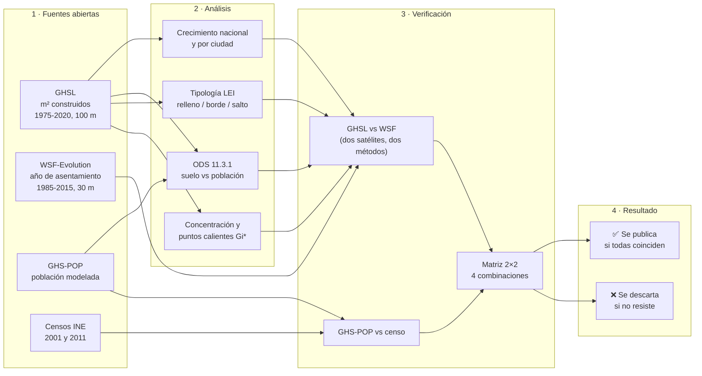

# P03 · Bitácora del proceso

Registro de cómo se construyó P03 ("Así crecieron las ciudades de Venezuela, 1985-2015"): datos, pasos, decisiones y verificaciones. La regla del proyecto es que **ninguna cifra se publica sin haber sido recalculada, testeada y contrastada**.

## El proceso en un vistazo

---

## 1. Datos

| Fuente | Qué aporta | Resolución | Épocas | Licencia |
|---|---|---|---|---|
| **GHS-BUILT-S R2023A** (JRC, Comisión Europea) | m² construidos (techos) por celda | 100 m, Mollweide (ESRI:54009) | 1975-2020 cada 5 años | CC BY 4.0 |
| **GHS-POP R2023A** (JRC) | Habitantes por celda, alineados con UN WPP 2022 | 100 m | 1975-2020 cada 5 años | CC BY 4.0 |
| **WSF-Evolution** (DLR) | Año de primera detección de asentamiento | ~30 m, EPSG:4326 | 1985-2015 anual | CC BY 4.0 |
| geoBoundaries VEN ADM0/ADM1 | Límites del país (sin Guayana Esequiba) y estados | — | — | CC BY 3.0 IGO |
| Nominatim (OpenStreetMap) | Verificación de nombres de lugares | — | — | ODbL |

**Qué épocas del GHSL son observadas** (GHSL Data Package 2023, sección 2.1): *"The data is made by spatial-temporal interpolation of five observed collections … Landsat data supports the 1975, 1990, 2000, and 2014 epochs, while a Sentinel-2 image composite supports the 2018 epoch."*

- Observadas: **1975, 1990, 2000** (y 2014 y 2018, cercanas a las épocas 2015 y 2020).
- Interpoladas: 1980, 1985, 1995, 2005, 2010, 2015.
- Extrapolada (corto plazo): 2020.
- **Proyectadas: 2025 y 2030 → no se usan.**

---

## 2. Pasos

| # | Script | Qué hace | Resultado clave |
|---|---|---|---|
| 1 | `download_ghsl.py` | Descarga los 6 tiles de 1000 km que cubren Venezuela (BUILT-S y POP, 1975-2020): 120 archivos, 0,65 GB | La grilla de tiles se verificó con el tile R8_C12, que contiene Caracas |
| 2 | `prepare.py` | Mosaico + recorte con el polígono del país; cifras nacionales por época | Construido: 675,6 → 1.457,4 km² (×2,16). Población: 12,95 → 28,04 M (×2,17) |
| 3 | `cities.py` | Ciudad = mancha urbana continua de 2020 (celdas con ≥15% construido + cierre de 300 m). Crecimiento e indicador ODS 11.3.1 por ciudad | Ver la sección 4 |
| 4 | `growth.py` | Tipología LEI, puntos calientes Gi\* del crecimiento y capa del Time Slider | Ver la sección 4 |
| 5 | `verify_wsf.py` | Verificación independiente del salto de los 90 con WSF-Evolution | Ver la sección 3.1 |
| 6 | `verify_wsf_cities.py` | La misma verificación por ciudad, con el mismo polígono en las dos fuentes | Ver la sección 3.2 |
| 7 | `verify_pop.py` | GHS-POP contra los censos del INE 2001 y 2011, por estado | Ver la sección 3.3 |
| 8 | `robustness_matrix.py` | ODS por ciudad con 2 fuentes de suelo × 2 de población | Ver la sección 3.4 |
| 9 | `wsf_layers.py` | Píxeles WSF, tipología LEI, concentración del crecimiento y puntos calientes Gi\* (Monte Carlo) con WSF y GHSL | Ver las secciones 3.6 y 3.7 |
| 10 | `layers_slider.py` | Capa anual del Time Slider (hexágonos ~0,74 km² con el año real de urbanización) y serie nacional | 2.541,9 → 4.389,4 km² (1985-2015) |
| 11 | `geolibre_project.py` | Proyectos de GeoLibre (video y explorar) | Ver la sección 4.2 |
| 12 | `video/record_slider.py`, `video/edit_slider.py` | Grabación cuadro a cuadro dentro de GeoLibre y textos bilingües | Ver la sección 4.2 |
| 13 | `lamina_proceso.py` | Lámina "Cómo verificamos" para el post | `output/como_verificamos.png` |
| 14 | `verify_claims.py` | Validación antes de publicar, T1-T4: artefactos de la serie anual, ODS con censos, línea base de la concentración, 18 variantes de la LEI | Ver la sección 3.8 y [`VALIDACION.md`](VALIDACION.md) |
| 15 | `verify_cities_census.py` | Validación T5: ODS por ciudad con el censo de los municipios, 36 combinaciones por ciudad | Ver la sección 3.8 y [`VALIDACION.md`](VALIDACION.md) |

---

## 3. Verificaciones

| Test | Resultado | ¿Pasa? |
|---|---|---|
| Área del país en la grilla del GHSL vs. área oficial | 918.620 vs 916.445 km² (+0,24%) | ✅ |
| Superficie construida del GHSL 2020 vs. techos de Overture (P01) | 1.457 vs 1.156 km²: dos fuentes independientes en el mismo orden de magnitud | ✅ |
| Sensibilidad del análisis por ciudad al umbral (10%, 15%, 20%) | Ranking e indicadores estables | ✅ |
| Nombres de las ciudades | Verificados con Nominatim; las etiquetas crudas eran parroquias (p. ej. "Bustamante" = Maracaibo, "La Morita" = Maracay-Turmero, "Ule/Baralt" = Costa Oriental del Lago, "Las Piedras/El Valle" = Margarita) | ✅ |
| Asociación de nombres en `growth.py` | Por centroide fallaba en manchas irregulares (3 ciudades sin nombre) → se corrigió asociando por orden, igual que en `cities.py` | ✅ corregido |
| **Salto de los 90 (GHSL: 3,28%/año en 1990-2000 vs 1,25% y 1,42%)** | Contrastado con WSF-Evolution (sección 3.1) | ⚠️ parcial |

### 3.1 Verificación independiente con WSF-Evolution (`verify_wsf.py`)

51 tiles de 2°×2° (otros 5 no existen porque son mar). Superficie de asentamiento WSF dentro de Venezuela: 2.594,9 km² (1985) → 4.457,6 km² (2015). El área de cada píxel se calcula según su latitud.

| Período | Población %/año | GHSL %/año | ODS con GHSL | WSF %/año | ODS con WSF |
|---|---|---|---|---|---|
| 1985-1990 | 2,53% | 1,27% | 0,50 | 2,15% | 0,85 |
| 1990-2000 | 2,14% | **3,28%** | **1,54** | **2,25%** | **1,05** |
| 2000-2015 | 1,49% | 1,42% | 0,95 | 1,39% | 0,94 |
| 1985-2015 | 1,88% | 2,02% | 1,07 | 1,80% | 0,96 |

En 17 de los 25 estados, 1990-2000 es el período de mayor crecimiento del WSF.

**Conclusiones:**

- ✅ **Se confirma:** las ciudades crecieron más rápido en los 90 que en 2000-2015 (las dos fuentes coinciden).
- ✅ **Se confirma:** en 2000-2015 y en el largo plazo (1985-2015) el suelo urbano creció al mismo ritmo que la población (ODS ≈ 1 con las dos fuentes).
- ❌ **No se confirma la magnitud del salto del GHSL en los 90.** Con WSF el ritmo fue del 2,25%/año, no del 3,28%, y ya venía cerca de ese nivel a fines de los 80 (2,15%). El contraste "lento en los 80 / explosivo en los 90" del GHSL es, al menos en parte, un efecto del método.
- ❌ **Por lo tanto no se publican** ni el ODS nacional de 1990-2000 = 1,54 ("expansión") ni el de 1975-1990 = 0,46 ("densificación") como hallazgos: con WSF dan 1,05 y 0,85.
- ⏳ **2015-2020 no se puede contrastar con WSF** (termina en 2015): queda como dato de modelo.

### 3.2 Verificación por ciudad con WSF-Evolution (`verify_wsf_cities.py`)

Se usó exactamente la misma extensión de cada ciudad en las dos fuentes (la mancha urbana de 2020 del GHSL, convertida a polígono y reproyectada a EPSG:4326).

- **1985-1990: las fuentes no coinciden en casi ninguna ciudad.** El GHSL da crecimientos bajísimos (0,2-0,9%/año) y el WSF a veces valores anómalos (Valencia 11,5%/año). Las primeras épocas son poco confiables en las dos fuentes → **no se usan períodos anteriores a 1990 por ciudad.**
- **Los multiplicadores 1975→2020 del GHSL no resisten**: Maturín ×3,98 y Margarita ×5,89 frente a ×1,9 en 1985-2015 con WSF. La base de 1975 del GHSL probablemente está subestimada → **no se publican multiplicadores por ciudad.**
- 2000-2015 es el período donde las dos fuentes más coinciden.

### 3.3 Verificación de la población con los censos del INE (`verify_pop.py`)

GHS-POP contra los censos 2001 y 2011 (INE, Cuadro 2.2), por estado:

| Test | Resultado |
|---|---|
| Distribución (participación de cada estado, GHS-POP 2010 vs censo 2011) | Correlación **0,994**, error medio 0,21 puntos de % |
| Dinámica (crecimiento anual por estado, GHS-POP 2000→2010 vs censo 2001→2011) | Correlación **0,79**, error medio 0,28 puntos de %/año |
| Totales | GHS-POP 2000 = 24,0 M vs censo 2001 = 23,1 M; GHS-POP 2010 = 28,2 M vs censo 2011 = 27,2 M (el censo no incluye la omisión censal; GHS-POP se alinea con la ONU) |

Diferencias grandes de crecimiento: Amazonas (censo 7,32% vs GHS 2,97%, probablemente por cambios en el censo indígena de 2011), Aragua (1,17 vs 0,73) y Carabobo (1,50 vs 1,93). El modelo reparte bien la población, pero **el crecimiento a nivel de ciudad tiene incertidumbre**.

### 3.4 Matriz de robustez del ODS por ciudad, 2000-2015 (`robustness_matrix.py`)

4 combinaciones: 2 fuentes de suelo (GHSL, WSF) × 2 fuentes de crecimiento de población (GHS-POP en la ciudad; crecimiento censal del estado como proxy). Se publica una lectura solo si las 4 coinciden.

| Ciudad | GHSL/GHS-POP | WSF/GHS-POP | GHSL/censo | WSF/censo | Lectura |
|---|---|---|---|---|---|
| Maracaibo | 0,59 | 0,42 | 0,51 | 0,36 | ✅ densificación robusta |
| Barquisimeto | 0,58 | 0,44 | 0,46 | 0,34 | ✅ densificación robusta |
| Barcelona-Puerto La Cruz | 0,43 | 0,40 | 0,35 | 0,32 | ✅ densificación robusta |
| Margarita | 0,26 | 0,27 | 0,27 | 0,28 | ✅ densificación robusta |
| Valencia | 0,80 | 0,54 | 0,96 | 0,64 | ❌ no concluyente |
| Caracas (valle), proxy Distrito Capital | 3,15 | 2,04 | 1,49 | 0,97 | ❌ depende del proxy |
| Caracas (valle), proxy DC + Miranda | 3,15 | 2,04 | 0,83 | 0,53 | ❌ no concluyente |
| Maracay-Turmero | 2,34 | 1,45 | 0,76 | 0,47 | ❌ no concluyente |
| Ciudad Guayana | 1,11 | 0,86 | 0,53 | 0,41 | ❌ no concluyente |
| Costa Oriental del Lago | 0,81 | 0,98 | 0,59 | 0,72 | ❌ no concluyente |
| Maturín | 1,05 | 0,80 | 1,37 | 1,05 | ❌ no concluyente |
| Caracas metropolitana | 1,85 | 1,38 | 1,10 | 0,82 | ❌ no concluyente |

**"Caracas se expandió" no resiste**: depende de cómo se mida su población. Para resolverlo haría falta el crecimiento censal de los municipios que forman la ciudad (no solo del estado).

### 3.5 Límites del país: una discrepancia detectada y resuelta

La tabla de píxeles WSF (recortada con el contorno del país, ADM0) suma 4.389,4 km², y `verify_wsf.py` (recortado con la unión de los estados, ADM1) dio 4.457,6 km²: un 1,5% de diferencia. **Causa:** las versiones simplificadas de geoBoundaries no encajan; hay 6.501 km² dentro de los estados pero fuera del contorno del país y 5.353 km² al revés, sobre todo en la costa.

- **Decisión para P03:** todo se recorta con el contorno del país (ADM0), igual que el GHSL. Con ADM0 la serie WSF queda en 2.541,9 → 4.389,4 km² (1985-2015) y las tasas cambian como máximo 0,03 puntos: **las conclusiones no cambian** (1985-1990: 2,16%, ODS 0,86; 1990-2000: 2,28%, ODS 1,07; 2000-2015: 1,40%, ODS 0,94; 1985-2015: 1,82%, ODS 0,97). Las cifras públicas (README) usan esta versión con ADM0.
- **Control de P01 (ya publicado), que asignó las construcciones con los estados:** de las 10.861.395 construcciones, 10.675.574 (98,29%) están dentro de Venezuela; 60.318 (0,56%) caen en la franja donde los polígonos simplificados de Venezuela y Colombia se superponen; 121.139 (1,12%) están en la costa, fuera del contorno simplificado pero en territorio venezolano; y solo **4.364 (0,04%)** quedan fuera de Venezuela según todos los polígonos (Colombia 2.409, Brasil 1.894, Guyana 61). **La cifra de P01 se sostiene; la incertidumbre por los límites simplificados es de como máximo ~0,6%.**

### 3.6 Tipología LEI y concentración del crecimiento: GHSL vs WSF, 2000-2015 (`wsf_layers.py`)

El WSF se llevó a la misma grilla de 100 m del GHSL (cada celda toma el primer año en que alguno de sus píxeles fue asentamiento).

| Tipo de crecimiento 2000-2015 | GHSL | WSF |
|---|---|---|
| Expansión de borde | 58,1% | 52,8% |
| Relleno | 31,8% | 38,4% |
| Salto (urbanización aislada) | 10,1% | 8,8% |

✅ **Mismo orden y valores cercanos**: más de la mitad del crecimiento fue en los bordes de las ciudades, entre el 32% y el 38% fue relleno, y cerca de 1 de cada 10 (8,8-10,1%) fue urbanización aislada.

**Dónde cayó el crecimiento 2000-2015.** Se ordenan las celdas H3 de mayor a menor crecimiento y se mide qué parte del territorio (por área real de las celdas) suma el 50, el 70 y el 90% del crecimiento, con las dos fuentes y tres tamaños de hexágono:

| % del territorio que concentra… | ~36 km² (res 6) WSF / GHSL | ~5 km² (res 7) WSF / GHSL | ~0,74 km² (res 8) WSF / GHSL |
|---|---|---|---|
| La mitad del crecimiento | 0,80% / 0,65% | **0,38% / 0,34%** | 0,20% / 0,19% |
| El 70% | 1,66% / 1,39% | 0,78% / 0,68% | 0,40% / 0,38% |
| El 90% | 4,06% / 3,64% | 1,78% / 1,65% | 0,85% / 0,85% |

✅ **Resiste**: la mitad del crecimiento 2000-2015 cayó en **menos del 1% del territorio** con las dos fuentes y las tres escalas. El "70% en menos del 1%" solo se cumple con hexágonos de ~5 km² o menos, así que no se usa como titular. Con hexágonos de ~5 km², las celdas que suman la mitad del crecimiento son 755 con WSF y 659 con GHSL; 483 están en las dos (Jaccard 0,52). Capa: `output/hex_r7_mitad_crecimiento.parquet` (las 755 celdas WSF, con la columna `tambien_en_ghsl`).

### 3.7 Puntos calientes Gi\* con Monte Carlo: el titular anterior no resiste (`wsf_layers.py`)

La primera versión de P03 decía **"el 70% del crecimiento 2000-2015 cayó en el 1,36% del territorio"**: las celdas calientes del Gi\* (99%, FDR) en las dos fuentes. Su significancia salía de la curva normal. En P02, Daniel mostró que con datos tan sesgados la normal exagera la significancia y la reemplazó por p-valores por simulación (Monte Carlo). Aquí el sesgo es mayor: **el 94% de las celdas no tiene crecimiento WSF**. Se repitió el cálculo con el mismo método que P02 (aleatorización total, 5 millones de simulaciones, semilla 2026, FDR de Benjamini-Hochberg):

| Gi\* 2000-2015, celdas de ~5 km² | Curva normal (versión anterior) | Monte Carlo 99% | Monte Carlo 95% | Monte Carlo 90% |
|---|---|---|---|---|
| Celdas calientes WSF / GHSL | 3.441 / 2.942 | 350 / 178 | 505 / 485 | 794 / 569 |
| Coincidencia entre fuentes (Jaccard) | 0,72 | 0,34 | 0,50 | 0,52 |
| Calientes en las dos fuentes | 1,36% del territorio | 0,07% | 0,17% | 0,24% |
| Crecimiento WSF dentro | 70,4% | 10,8% | 21,6% | 27,0% |

❌ **No resiste.** Con Monte Carlo los puntos calientes se reducen a una fracción y las dos fuentes apenas coinciden. Se descarta como hallazgo y se reemplaza por la concentración directa (3.6), que no depende de una prueba de significancia. El detalle queda en `output/p03_contraste_lei_gistar.json` (`gistar_2000_2015_descartado`).

> La tipología 1975-2015 y los puntos calientes 1975-2020 calculados solo con el GHSL (`growth.py`) **no se publican**: incluyen las épocas poco confiables. Se publica la versión 2000-2015 contrastada.

### 3.8 Validación antes de publicar (`verify_claims.py`, `verify_cities_census.py`)

Antes de publicar se reprodujo todo desde cero (salidas idénticas; con DuckDB 2.0 `wsf_layers.py` falla, así que se fijó `duckdb<2`) y cada afirmación pasó por cinco pruebas que podían tumbarla. El detalle, los criterios y la guía de lenguaje están en **[`VALIDACION.md`](VALIDACION.md)**.

| Prueba | Resultado | Qué cambia |
|---|---|---|
| T1 · Artefactos de la serie anual WSF | En 1996, 19 de 23 estados saltan a la vez (en 1991, 14); después de 2000, nunca más de 3 | "Los 90 más rápido" resiste aunque parte de lo de 1991 sea anterior; no se comenta ningún año antes de 2000 |
| T2 · ODS nacional con censos del INE | 2000-2015: 0,88-0,95 en 6 combinaciones. Largo plazo: WSF 0,96, GHSL 1,22 | Se publica "el suelo no creció más rápido que la población" en 2000-2015; el "≈ 1 a largo plazo" queda solo con WSF |
| T3 · Línea base de la concentración | Lo existente en 2000 estaba igual de concentrado (0,30% del territorio con hexágonos de ~5 km²); con hexágonos de ~250 km² la cifra pasa del 1% | "La mitad en menos del 1%" deja de ser el titular y va con su línea base |
| T4 · 18 variantes de la LEI | Borde 51-74% (el tipo más común en las 18); relleno + borde 89-96% | Titular nuevo: "9 de cada 10 km² nuevos, pegados a lo existente". No se publican los repartos exactos |
| T5 · Censo por municipio | Barquisimeto, Barcelona-PLC y Margarita resisten 36 de 36; Caracas sigue sin lectura (0,86-1,71) | Maracaibo queda pendiente del censo municipal de Zulia |

---

## 4. Resultados crudos, antes de verificar (lo publicable está en 4.1)

**Nacional, indicador ODS 11.3.1 (ritmo del suelo construido ÷ ritmo de la población):** con el GHSL, 1975-1990 = 0,46 · 1990-2000 = 1,54 · 2000-2015 = 0,95 · 2015-2020: la población cae (−1,39%/año, según GHS-POP alineado con la ONU) mientras lo construido sigue creciendo (+0,79%/año). **Tras la verificación (3.1), solo son publicables:** el equilibrio de largo plazo (≈1 con las dos fuentes), que los 90 crecieron más rápido que 2000-2015 y, con la etiqueta de "modelo", el período 2015-2020.

**Por ciudad (umbral 15%):** Maracaibo ×1,57 · Valencia ×1,83 · Caracas (valle) ×1,63 · Maracay-Turmero ×1,60 · Barquisimeto ×1,53 · Ciudad Guayana ×1,67 · Costa Oriental ×1,65 · Barcelona-Puerto La Cruz ×1,45 · **Maturín ×3,98** · **Margarita ×5,89**. Caracas metropolitana (núcleos a menos de 35 km): ODS 1975-2020 = 2,27.

**Tipología del crecimiento (LEI, nacional):** el relleno pasa del 19% (1975-1990) al 41% (2015-2020); en 1975-1990 dominaban los saltos (37,5%).

**Puntos calientes del crecimiento 1975-2020 (Gi\*, FDR):** el 1,63% del territorio concentra el 77,3% de lo construido nuevo.

---

## 4.1 Qué es publicable hoy (después de todas las verificaciones y de la validación §3.8)

| Afirmación | Estado |
|---|---|
| 2000-2015: 9 de cada 10 km² nuevos, pegados a lo ya urbanizado (relleno + borde 89-96%); el borde es la forma más común | ✅ dos fuentes y 18 variantes del método (T4) |
| 2000-2015: el suelo urbano no creció más rápido que la población (ODS 0,88-0,95) | ✅ dos fuentes de suelo × modelo, censo y estimación del INE (T2) |
| A largo plazo (1985/1990-2011/2015), el suelo urbano creció al ritmo de la población (ODS ≈ 1) | 🟡 solo con WSF (0,96-0,97); el GHSL da 1,07-1,22 (T2) |
| Las ciudades crecieron más rápido en los 90 que en 2000-2015 | 🟡 dirección sí (resiste el escenario pesimista de T1), magnitud no |
| Entre 2000 y 2015, en Barquisimeto, Barcelona-Puerto La Cruz y Margarita la población creció más rápido que la superficie urbanizada | ✅ 36 de 36 combinaciones, con censo municipal (T5) |
| Ídem para Maracaibo | ⏳ 27 de 27 combinaciones disponibles; falta el censo municipal de Zulia (T5) |
| Magnitud del salto de los 90 (3,28%/año, ODS 1,54) | ❌ no resiste |
| Saltos de un año en 1991 y 1996 | ❌ artefacto de disponibilidad de imágenes (T1) |
| Multiplicadores 1975→2020 por ciudad (Maturín ×4, Margarita ×6…) | ❌ no resisten |
| "Caracas se expandió" / "Caracas se densificó" | ❌ no concluyente, también con censo municipal (T5) |
| 2015-2020: la población cae y lo construido sigue creciendo | ⏳ solo modelo (GHSL + ONU), sin contraste posible |
| Tipología 2000-2015 con repartos exactos (32-38% relleno, ~1 de cada 10 saltos) | ❌ dependen del método: relleno 21-41%, salto 4-11% (T4) |
| La mitad del crecimiento 2000-2015 cayó en menos del 1% del territorio | 🟡 cierta con hexágonos de hasta ~36 km², pero igual de concentrada que lo que ya existía: no va como titular (T3) |
| "El 70% del crecimiento 2000-2015 cayó en el 1,36% del territorio" (puntos calientes) | ❌ no resiste Monte Carlo (3.7) |
| Tipología y puntos calientes desde 1975 (solo GHSL) | ❌ no se publican (épocas poco confiables) |
| La cifra de P01 (10.861.395) frente a los límites del país | ✅ se sostiene; incertidumbre de límites ≤ ~0,6% (3.5) |

## 4.2 Visualización en GeoLibre y video

- **Fuente del Time Slider: WSF-Evolution** (la que pasó las verificaciones), con **años reales, uno por uno, 1985-2015**. Capa `output/hex_r8_urbanizacion_wsf.parquet` (`layers_slider.py`): hexágonos H3 de ~0,74 km² con el año en que su asentamiento superó el 10% del hexágono (1985 = ya lo era).
- **Proyectos** (`geolibre_project.py`): `geolibre/p03_video.geolibre.json` y `geolibre/p03_explorar.geolibre.json`. Mapa base oscuro; en gris, lo que ya existía en 1985; de violeta (1986) a amarillo (2015), lo nuevo; con contornos celestes, las celdas de ~5 km² que suman la mitad del crecimiento 2000-2015 (WSF).
- **Por qué el eje central y no todo el país:** el crecimiento total (≈4.400 km² en un país de 916.000) se ve como puntos sueltos a escala nacional; el eje Valencia-Maracay-Caracas-Valles del Tuy concentra buena parte del crecimiento.
- **Video** (`video/record_slider.py` + `video/edit_slider.py`): 19,2 s, grabado dentro de GeoLibre cuadro a cuadro, con 0 diagnósticos de GeoLibre al grabar. El contador muestra el año y los km² de asentamiento de todo el país (serie WSF con el contorno de Venezuela). **Solo muestra hallazgos que resistieron las verificaciones** (§4.1): la mitad del crecimiento 2000-2015 en menos del 1% del territorio (0,38% con WSF en hexágonos de ~5 km²), y más de la mitad del crecimiento en los bordes de las ciudades.
- **Pendiente tras la validación (§3.8):** los textos del video siguen siendo los de la primera versión. El primero queda en 🟡 (le falta la línea base de T3) y el segundo es más débil que "9 de cada 10 km² nuevos, pegados a lo existente" (T4). Además, el contador y el slider muestran los saltos de 1991 y 1996, que son artefactos (T1). Si no se regraba, el post debe aclararlo.

## 5. Decisiones y cuidados

- **El cociente ODS se dispara cuando la población casi no crece** (Caracas 1990-2000 = 9,07). Se publican también las tasas (suelo %/año y población %/año), no solo el cociente.
- **Los m² del GHSL no se mezclan con el conteo de techos de P01**: son definiciones distintas.
- **La caída de población 2015-2020 viene de un modelo** (GHS-POP alineado con UN WPP 2022), no de un censo. Si se publica, va con la fuente y en tono descriptivo, sin afirmar causas.
- **"km² nuevos" en el LEI** es el área de las celdas de 1 ha que pasaron a ser urbanas, no superficie de techos.
