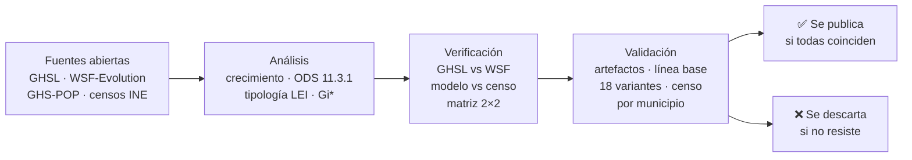

# P03 · Así crecieron las ciudades de Venezuela, 1985-2015

**Entre 2000 y 2015, 9 de cada 10 km² nuevos de asentamiento aparecieron pegados a zonas que ya eran urbanas, y el suelo urbano creció algo más lento que la población.** Coinciden dos productos satelitales elaborados por equipos distintos y los censos del INE.

> **EN** · *How Venezuela's cities grew, 1985-2015*: between 2000 and 2015, 9 out of 10 km² of new settlement appeared right next to areas that were already urban, as infill or at the edges of cities; edge expansion was the most common form. Urban land grew slightly slower than the population (UN SDG 11.3.1 between 0.88 and 0.95). Both findings hold in two satellite products built by different teams (GHSL from the EU's JRC and WSF-Evolution from the German Aerospace Center, DLR), with modelled and census population, and across 18 variants of the method. In Barquisimeto, Barcelona-Puerto La Cruz and Margarita, population grew faster than urban land in all 36 combinations of sources and methods we tested, including municipal census data. Just as important: we list what we **discarded** because it did not survive verification, and every test is in [`VALIDACION.md`](VALIDACION.md). The video was recorded inside [GeoLibre](https://geolibre.app) with its Time Slider, year by year. Use **Open in GeoLibre** below to play it yourself.

## Ábrelo tú mismo

**[Abrir en GeoLibre](https://web.geolibre.app/?welcome=0&theme=dark&url=https%3A%2F%2Fraw.githubusercontent.com%2FKaimind-Technologies%2Fvenezuela-datos-abiertos%2Fmain%2Fp03-crecimiento%2Fgeolibre%2Fp03_explorar.geolibre.json)**: el eje central (Valencia, Maracay, Caracas, Valles del Tuy) en hexágonos 3D sobre un mapa oscuro, con el Time Slider listo. Dale ▶ (o avanza con ⏭) para verlo crecer año a año, de 1985 a 2015.

Cómo leerlo:

- Cada hexágono mide ~0,74 km² (H3 resolución 8). Aparece el año en que su asentamiento superó el 10% de su área.
- **Gris**: ya era asentamiento en 1985 (o antes). **De violeta (1986) a amarillo (2015)**: lo nuevo.
- **Altura**: cuánto del hexágono es asentamiento en 2015.
- **Contornos celestes**: las celdas de ~5 km² que, juntas, suman la mitad del crecimiento 2000-2015 (WSF). La capa dice además si cada celda también está entre las que suman la mitad según el GHSL.
- A diferencia de P02, aquí los años del slider **son años reales**.
- **Los saltos de 1991 y 1996 no son auges de construcción.** Ese año aparecen hexágonos nuevos en casi todo el país a la vez, después de años con muy pocos: es lo que pasa cuando faltan imágenes satelitales y lo construido se detecta tarde ([`VALIDACION.md`](VALIDACION.md), T1). Antes de 2000, léelo por décadas, no año a año.

## Hallazgos que resistieron las verificaciones

Cada hallazgo pasó, además, las pruebas de [`VALIDACION.md`](VALIDACION.md): artefactos de la serie anual, censos en vez de modelos de población, línea base de la concentración, 18 variantes del método y censo por municipio.

| Hallazgo | Cifra | Cómo se verificó |
|---|---|---|
| Las ciudades crecieron pegadas a lo que ya existía | 2000-2015: **9 de cada 10 km² nuevos** (89-96%) fueron relleno o expansión de borde. La **expansión de borde** fue la forma más común (51-74%) | Tipología LEI con las dos fuentes, 3 reglas o umbrales por fuente y anillos de 100, 200 y 300 m: 18 variantes ([T4](VALIDACION.md#t4-sensibilidad-de-la-tipología-lei-2000-2015-verify_claimspy)) |
| En 2000-2015 el suelo urbano no creció más rápido que la población | ODS 11.3.1 entre **0,88 y 0,95** | 2 fuentes de suelo × 3 de población: modelo GHS-POP, censos del INE y estimación del INE corregida por omisión ([T2](VALIDACION.md#t2-ods-1131-nacional-con-población-de-censos-verify_claimspy)) |
| En Barquisimeto, Barcelona-Puerto La Cruz y Margarita la población creció más rápido que la superficie urbanizada (2000-2015) | ODS entre **0,24 y 0,59** (Margarita 0,24-0,36; Barcelona-PLC 0,29-0,45; Barquisimeto 0,32-0,59) | **36 combinaciones** por ciudad: 3 medidas de suelo × 4 de población (modelo, censo del estado, censo de los municipios, estimación del INE) × 3 umbrales de la mancha urbana ([T5](VALIDACION.md#t5-ciudades-con-el-censo-de-sus-municipios-verify_cities_censuspy)) |
| Los 90 crecieron más rápido que 2000-2015, igual que la población | WSF: unos 65-72 km²/año en los 90 frente a unos 56 km²/año en 2000-2015 | GHSL, WSF y censos coinciden en la **dirección**. Resiste aunque parte de lo fechado en 1991 sea anterior a 1990 ([T1](VALIDACION.md#t1-saltos-de-un-año-en-la-serie-anual-wsf-verify_claimspy)). La magnitud no se publica |
| El crecimiento cayó donde ya había ciudad | La mitad del crecimiento 2000-2015 cayó en menos del 1% del territorio (hexágonos de hasta ~36 km²), **tan concentrado como las ciudades que ya existían en 2000** | Dos fuentes y cuatro tamaños de hexágono, con la concentración de lo existente como línea base ([T3](VALIDACION.md#t3-línea-base-de-la-concentración-verify_claimspy)). Los asentamientos ocupan el 0,5% del país, así que la cifra sola no indica una concentración nueva |

Maracaibo también da ODS menor que 1 en las 27 combinaciones disponibles, pero falta el censo de sus municipios para completar las 36: queda pendiente ([`VALIDACION.md`](VALIDACION.md#pendientes)).

**Superficie de asentamiento de Venezuela (WSF-Evolution):** unos 2.500 km² en 1985 y unos 4.400 km² en 2015. El contador del video muestra la serie anual exacta.

El ODS 11.3.1 de la ONU compara el ritmo al que crece el suelo urbano con el ritmo al que crece la población. Si es menor que 1, la población crece más rápido que el suelo urbanizado (la ONU lo llama densificación); si es mayor, el suelo crece más rápido que la gente. El indicador no dice si eso es bueno o malo: más habitantes por km² puede ser edificios más altos, lotes vacíos que se ocupan o hacinamiento.

## Lo que descartamos (y por qué)

| Lo que parecía | Por qué no se publica |
|---|---|
| Un "boom" en los 90: el GHSL da 3,28%/año en 1990-2000 (ODS 1,54, "expansión") | WSF-Evolution da 2,28%/año (ODS 1,07) y ya venía en ese nivel a fines de los 80. El salto del GHSL es, al menos en parte, un efecto de cómo interpola entre épocas |
| Auges en 1991 y 1996 (el slider y el contador del video saltan esos años) | En 1996, 19 de 23 estados saltan a la vez, y en 1991, 14; antes vienen años anormalmente bajos. Es la firma de años con pocas imágenes Landsat, no de auges reales. Después de 2000 nunca saltan más de 3 estados a la vez ([T1](VALIDACION.md#t1-saltos-de-un-año-en-la-serie-anual-wsf-verify_claimspy)) |
| "A largo plazo el suelo creció al ritmo de la población" (ODS ≈ 1) como coincidencia de dos fuentes | Con WSF da 0,96-0,97 (con censos y con modelo), pero el GHSL da 1,07-1,22 porque arrastra su salto de los 90. Solo lo sostiene una fuente ([T2](VALIDACION.md#t2-ods-1131-nacional-con-población-de-censos-verify_claimspy)) |
| Repartos exactos de la tipología ("relleno 32-38%", "~1 de cada 10 saltos") | Dependen del método: con anillos de 100 a 300 m y otras reglas, el relleno va del 21% al 41% y los saltos del 4% al 11%. Lo que no cambia es que el borde es lo más común y que 9 de cada 10 km² nuevos están pegados a lo existente ([T4](VALIDACION.md#t4-sensibilidad-de-la-tipología-lei-2000-2015-verify_claimspy)) |
| Multiplicadores por ciudad desde 1975 (Maturín ×4, Margarita ×6) | Con WSF, en 1985-2015, las dos ciudades crecen ×1,9. La base de 1975 del GHSL parece subestimada, y antes de 1990 las fuentes no coinciden en casi ninguna ciudad |
| "Caracas se expandió" (ODS 3,15 con el modelo de población), o "Caracas se densificó" | Con el censo de sus municipios, la población del valle creció 0,50%/año (Baruta y Chacao perdieron habitantes entre 2001 y 2011), y el ODS queda entre 0,86 y 1,71 según la fuente de suelo. No hay lectura en ningún sentido ([T5](VALIDACION.md#t5-ciudades-con-el-censo-de-sus-municipios-verify_cities_censuspy)) |
| "El 70% del crecimiento 2000-2015 cayó en el 1,36% del territorio" (puntos calientes Getis-Ord Gi\* confirmados por las dos fuentes) | Esa versión tomaba la significancia de la curva normal. Con 94% de celdas sin crecimiento, la normal la exagera: con p-valores por simulación (Monte Carlo, 5 millones, el mismo método de P02), las celdas calientes en las dos fuentes son el 0,07% del territorio con el 11% del crecimiento, y las fuentes apenas coinciden (Jaccard 0,34, antes 0,72). Lo reemplazamos por la concentración directa, que no depende de esa prueba |
| 2015-2020: la población cae mientras lo construido sigue creciendo | WSF-Evolution termina en 2015, así que no hay segunda fuente. Queda como dato de modelo, no como hallazgo |

## El proceso



La regla: **ninguna cifra se publica sin haber sido recalculada y contrastada con una segunda fuente**, y sin pasar las pruebas que podían tumbarla. El registro completo, con cada test, cada número y cada decisión, está en **[`PROCESO.md`](PROCESO.md)**. Las pruebas finales, los criterios de publicación y la guía de lenguaje están en **[`VALIDACION.md`](VALIDACION.md)**. La lámina del post lo resume: [`output/como_verificamos.png`](output/como_verificamos.png).

## Limitaciones

- **Las dos fuentes miden cosas distintas.** GHSL estima m² construidos (techos) por celda de 100 m; WSF marca píxeles de ~30 m como asentamiento. Por eso se comparan ritmos, patrones y lugares, no km² absolutos.
- **Las dos fuentes se basan sobre todo en imágenes Landsat.** Los algoritmos y los equipos son distintos, pero las imágenes de origen se comparten en buena parte: si coinciden, se descarta un error de método, no un hueco en el archivo de imágenes. Por eso buscamos esos huecos aparte ([T1](VALIDACION.md#t1-saltos-de-un-año-en-la-serie-anual-wsf-verify_claimspy)).
- **La serie anual de WSF antes de 2000 no se lee año a año.** Los años con pocas imágenes desplazan lo construido al siguiente año con buenas imágenes.
- **WSF-Evolution termina en 2015.** Lo posterior solo existe en el GHSL, que es un modelo para 2020 (y una proyección para 2025-2030, que no se usa).
- **La población de las ciudades viene de un modelo** (GHS-POP). Reparte bien la población entre estados (correlación 0,994 con el censo de 2011), pero su crecimiento por ciudad tiene incertidumbre. Por eso los hallazgos por ciudad usan también el censo de los estados y de los municipios (2001-2011), que no cubre 2011-2015.
- **Antes de 1990, por ciudad, las fuentes no son confiables.** No se usan esos períodos.
- **Límites:** contorno de Venezuela de geoBoundaries (sin la Guayana Esequiba), en versión simplificada.

## Reproducir

```bash
pip install -r ../requirements.txt
python -P ../common/boundaries.py      # límites de Venezuela
python -P download_ghsl.py             # GHS-BUILT-S y GHS-POP 1975-2020 (6 tiles, ~0,65 GB)
python -P prepare.py                   # mosaico y recorte con el contorno del país
python -P cities.py                    # manchas urbanas y ODS por ciudad
python -P growth.py                    # LEI y Gi* con el GHSL
python -P verify_wsf.py                # descarga WSF-Evolution (51 tiles) y contraste nacional
python -P verify_wsf_cities.py         # contraste por ciudad, mismo polígono en las dos fuentes
python -P verify_pop.py                # GHS-POP contra los censos 2001 y 2011
python -P robustness_matrix.py         # matriz 2×2 del ODS por ciudad
python -P wsf_layers.py                # LEI, concentración y Gi* (Monte Carlo) con WSF y GHSL
python -P verify_claims.py             # validación T1-T4: artefactos, censos, línea base, variantes de la LEI
python -P verify_cities_census.py      # validación T5: ODS por ciudad con el censo de los municipios
python -P layers_slider.py             # capa del Time Slider y serie anual
python -P geolibre_project.py --base <url de esta carpeta>   # proyectos de GeoLibre
python -P lamina_proceso.py            # lámina "Cómo verificamos" (output/como_verificamos.png)
```

### Video

Se grabó dentro de GeoLibre, cuadro a cuadro: [`video/record_slider.py`](video/record_slider.py) abre el proyecto y avanza el Time Slider año por año, y [`video/edit_slider.py`](video/edit_slider.py) dibuja los textos bilingües, el contador y la leyenda. Para probar capas locales en GeoLibre hace falta un servidor con lectura por rangos: [`../common/serve_range.py`](../common/serve_range.py).

Fuentes, licencias y citas: [`../DATA_SOURCES.md`](../DATA_SOURCES.md).
