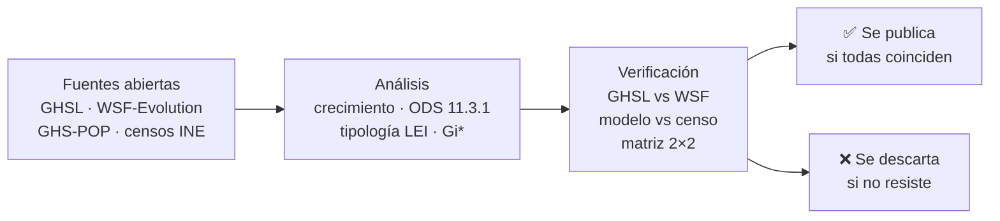

# P03 · Así crecieron las ciudades de Venezuela, 1985-2015

**La mitad del crecimiento urbano de 2000-2015 cayó en menos del 1% del territorio, y más de la mitad fue en los bordes de las ciudades.** Lo confirman dos fuentes satelitales independientes.

> **EN** · *How Venezuela's cities grew, 1985-2015*: half of 2000-2015 urban growth landed on less than 1% of the country's land (0.34-0.38% on ~5 km² hexagons), and more than half of it happened at the edges of existing cities. Both findings hold in two independent satellite datasets (GHSL from the EU's JRC and WSF-Evolution from the German Aerospace Center, DLR). Over the long run, urban land grew at the same pace as the population (UN SDG 11.3.1 ≈ 1), and between 2000 and 2015 Maracaibo, Barquisimeto, Barcelona-Puerto La Cruz and Margarita densified. Just as important: we list what we **discarded** because it did not survive verification. The video was recorded inside [GeoLibre](https://geolibre.app) with its Time Slider, year by year. Use **Open in GeoLibre** below to play it yourself.

## Ábrelo tú mismo

**[Abrir en GeoLibre](https://web.geolibre.app/?welcome=0&theme=dark&url=https%3A%2F%2Fraw.githubusercontent.com%2FKaimind-Technologies%2Fvenezuela-datos-abiertos%2Fmain%2Fp03-crecimiento%2Fgeolibre%2Fp03_explorar.geolibre.json)**: el eje central (Valencia, Maracay, Caracas, Valles del Tuy) en hexágonos 3D sobre un mapa oscuro, con el Time Slider listo. Dale ▶ (o avanza con ⏭) para verlo crecer año a año, de 1985 a 2015.

Cómo leerlo:

- Cada hexágono mide ~0,74 km² (H3 resolución 8). Aparece el año en que su asentamiento superó el 10% de su área.
- **Gris**: ya era asentamiento en 1985 (o antes). **De violeta (1986) a amarillo (2015)**: lo nuevo.
- **Altura**: cuánto del hexágono es asentamiento en 2015.
- **Contornos celestes**: las celdas de ~5 km² que, juntas, suman la mitad del crecimiento 2000-2015 (WSF). La capa dice además si cada celda también está entre las que suman la mitad según el GHSL.
- A diferencia de P02, aquí los años del slider **son años reales**.

## Hallazgos que resistieron las verificaciones

| Hallazgo | Cifra | Cómo se verificó |
|---|---|---|
| El crecimiento urbano 2000-2015 se concentró en muy poco territorio | **La mitad** del crecimiento cayó en **menos del 1% del territorio**: 0,38% (WSF) y 0,34% (GHSL) en hexágonos de ~5 km² | Con las dos fuentes y tres tamaños de hexágono: 0,80% / 0,65% (~36 km²), 0,38% / 0,34% (~5 km²), 0,20% / 0,19% (~0,74 km²). Curva completa (50, 70 y 90%) en [`output/p03_contraste_lei_gistar.json`](output/p03_contraste_lei_gistar.json) |
| Las ciudades crecieron sobre todo por sus bordes | 2000-2015: **expansión de borde 53-58%**, relleno 32-38%, saltos aislados 9-10% | Tipología LEI con las dos fuentes sobre la misma grilla de 100 m: mismo orden y valores cercanos |
| A largo plazo, el suelo urbano creció al ritmo de la población | ODS 11.3.1, 1985-2015: **0,97** (WSF) y **1,07** (GHSL) | Dos fuentes de suelo; la población del modelo GHS-POP se contrastó con los censos del INE (correlación 0,994 por estado) |
| Los 90 crecieron más rápido que 2000-2015 | WSF: 2,28%/año vs 1,40%/año | Las dos fuentes coinciden en la **dirección** (no en la magnitud, ver abajo) |
| Maracaibo, Barquisimeto, Barcelona-Puerto La Cruz y Margarita se densificaron entre 2000 y 2015 | ODS por debajo de 1 en las **4 combinaciones** (Margarita 0,26-0,28; Barcelona-PLC 0,32-0,43; Barquisimeto 0,34-0,58; Maracaibo 0,36-0,59) | Matriz 2×2: 2 fuentes de suelo × 2 fuentes de población (modelo GHS-POP y crecimiento censal del estado) |

**Superficie de asentamiento de Venezuela (WSF-Evolution):** 2.541,9 km² en 1985 → 4.389,4 km² en 2015. Es lo que muestra el contador del video.

El ODS 11.3.1 de la ONU compara el ritmo al que crece el suelo urbano con el ritmo al que crece la población. Si es menor que 1, la ciudad se densifica; si es mayor, se expande más rápido que su gente.

## Lo que descartamos (y por qué)

| Lo que parecía | Por qué no se publica |
|---|---|
| Un "boom" en los 90: el GHSL da 3,28%/año en 1990-2000 (ODS 1,54, "expansión") | WSF-Evolution da 2,28%/año (ODS 1,07) y ya venía en ese nivel a fines de los 80. El salto del GHSL es, al menos en parte, un efecto de cómo interpola entre épocas |
| Multiplicadores por ciudad desde 1975 (Maturín ×4, Margarita ×6) | Con WSF, en 1985-2015, las dos ciudades crecen ×1,9. La base de 1975 del GHSL parece subestimada, y antes de 1990 las fuentes no coinciden en casi ninguna ciudad |
| "Caracas se expandió" (ODS 3,15 con el modelo de población) | Con el crecimiento censal del estado como población, el ODS va de 0,53 a 1,49 según la fuente de suelo y el estado que se use. Depende de cómo se mida la población; resolverlo requiere el censo por municipio |
| "El 70% del crecimiento 2000-2015 cayó en el 1,36% del territorio" (puntos calientes Getis-Ord Gi\* confirmados por las dos fuentes) | Esa versión tomaba la significancia de la curva normal. Con 94% de celdas sin crecimiento, la normal la exagera: con p-valores por simulación (Monte Carlo, 5 millones, el mismo método de P02), las celdas calientes en las dos fuentes son el 0,07% del territorio con el 11% del crecimiento, y las fuentes apenas coinciden (Jaccard 0,34, antes 0,72). Lo reemplazamos por la concentración directa, que no depende de esa prueba |
| 2015-2020: la población cae mientras lo construido sigue creciendo | WSF-Evolution termina en 2015, así que no hay segunda fuente. Queda como dato de modelo, no como hallazgo |

## El proceso



La regla: **ninguna cifra se publica sin haber sido recalculada y contrastada con una segunda fuente.** El registro completo, con cada test, cada número y cada decisión, está en **[`PROCESO.md`](PROCESO.md)**. La lámina del post lo resume: [`output/como_verificamos.png`](output/como_verificamos.png).

## Limitaciones

- **Las dos fuentes miden cosas distintas.** GHSL estima m² construidos (techos) por celda de 100 m; WSF marca píxeles de ~30 m como asentamiento. Por eso se comparan ritmos, patrones y lugares, no km² absolutos.
- **WSF-Evolution termina en 2015.** Lo posterior solo existe en el GHSL, que es un modelo para 2020 (y una proyección para 2025-2030, que no se usa).
- **La población de las ciudades viene de un modelo** (GHS-POP). Reparte bien la población entre estados (correlación 0,994 con el censo de 2011), pero su crecimiento por ciudad tiene incertidumbre. Por eso los hallazgos por ciudad usan también el censo.
- **Antes de 1990, por ciudad, las fuentes no son confiables.** No se usan esos períodos.
- **Límites:** contorno de Venezuela de geoBoundaries (sin la Guayana Esequiba), en versión simplificada.

## Reproducir

```bash
pip install -r ../requirements.txt
python -P ../common/boundaries.py      # límites de Venezuela
python -P download_ghsl.py             # GHS-BUILT-S y GHS-POP 1975-2020 (6 tiles, ~0,65 GB)
python -P prepare.py                   # mosaico y recorte con el contorno del país
python -P cities.py                    # manchas urbanas y ODS por ciudad
python -P growth.py                    # LEI y Gi* con el GHSL
python -P verify_wsf.py                # descarga WSF-Evolution (51 tiles) y contraste nacional
python -P verify_wsf_cities.py         # contraste por ciudad, mismo polígono en las dos fuentes
python -P verify_pop.py                # GHS-POP contra los censos 2001 y 2011
python -P robustness_matrix.py         # matriz 2×2 del ODS por ciudad
python -P wsf_layers.py                # LEI, concentración y Gi* (Monte Carlo) con WSF y GHSL
python -P layers_slider.py             # capa del Time Slider y serie anual
python -P geolibre_project.py --base <url de esta carpeta>   # proyectos de GeoLibre
python -P lamina_proceso.py            # lámina "Cómo verificamos" (output/como_verificamos.png)
```

### Video

Se grabó dentro de GeoLibre, cuadro a cuadro: [`video/record_slider.py`](video/record_slider.py) abre el proyecto y avanza el Time Slider año por año, y [`video/edit_slider.py`](video/edit_slider.py) dibuja los textos bilingües, el contador y la leyenda. Para probar capas locales en GeoLibre hace falta un servidor con lectura por rangos: [`../common/serve_range.py`](../common/serve_range.py).

Fuentes, licencias y citas: [`../DATA_SOURCES.md`](../DATA_SOURCES.md).
